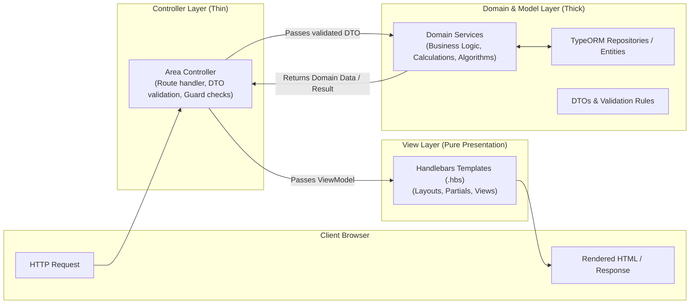

# TrueLabel Project Rules & Engineering Protocol

> **CRITICAL DIRECTIVE**: This document defines the non-negotiable architectural, coding, testing, and documentation standards for the **TrueLabel** platform. All code additions, refactoring, and contributions must strictly comply with these rules.

---

## 0. AI Agent & Developer Onboarding Protocol (First-Time Setup)

When anyone (developer or AI agent) starts working on this project for the first time, the AI agent must strictly follow this initialization procedure upon the initial prompt/session:

1. **Mandatory Skill Verification & Automatic Installation**:
   - The AI agent **must automatically check** whether the `frontend-design` skill is installed in the project (under `.agents/skills/frontend-design/` or in the agent's available skills).
   - If the skill is not installed or missing, the AI agent **must automatically execute the installation command**:
     ```bash
     npx skills add https://github.com/anthropics/skills --skill frontend-design
     ```
2. **Fallback Notification Directive**:
   - If the automatic installation cannot be executed or fails (e.g., due to sandbox/network restrictions or missing CLI binaries), the AI agent **must immediately instruct the user** to install it manually by running:
     ```bash
     npx skills add https://github.com/anthropics/skills --skill frontend-design
     ```
3. **Mandatory Application of `frontend-design` on ALL Frontend Work**:
   - Every frontend view, template, UI component, and redesign **MUST strictly follow the `frontend-design` skill** instructions (`.agents/skills/frontend-design/SKILL.md`).
   - Building or modifying frontend views using generic AI defaults without activating and adhering to the `frontend-design` skill is strictly prohibited.
4. **Mandatory Mobile-First Optimization for Every Feature**:
   - Every new feature, UI view, dashboard, card, modal, or layout **MUST be fully responsive and explicitly optimized for mobile viewports** (down to 320px/360px) in accordance with Section 7.
5. **Mandatory Pagination on All Lists & Collections**:
   - Every feature presenting any list, table, feed, directory, or collection **MUST be paginated** at both the database level and the view layer in accordance with Section 8. Unbounded table scans and unpaginated DOM rendering are strictly prohibited.

---

## 1. Strict MVC Protocol & Boundary Enforcement

The system follows a strict **Model-View-Controller (MVC)** architectural design. Cross-layer leakage is strictly prohibited.



### 1.1. The Controller Layer (`Controllers/`)
* **Role**: Acts purely as the traffic conductor between incoming HTTP requests and internal domain services.
* **Responsibilities**:
  1. Routing HTTP GET, POST, PUT, DELETE requests.
  2. Enforcing Authentication and Role Guards (`@UseGuards(AuthenticatedGuard, RolesGuard)`).
  3. Validating incoming payloads using class-validator DTOs (`@UsePipes(ValidationPipe)`).
  4. Delegating business logic exclusively to Domain Services.
  5. Selecting the view to render (`@Render('view-path')`) with a clean ViewModel or issuing an HTTP Redirect.
* **Prohibitions**:
  - **NO direct database queries** (No TypeORM repository calls inside controllers).
  - **NO business logic calculations** (e.g., score computation, diet calculations, allergen matching must NOT exist in controllers).
  - **Maximum method length**: ~15–25 lines.

### 1.2. The Model & Service Layer (`Models/` & `Services/`)
* **Role**: Owns all domain state, entities, validation rules, data access, and business algorithms.
* **Responsibilities**:
  1. **Entities**: Define database schema, relations, foreign keys, and column constraints using TypeORM.
  2. **DTOs (Data Transfer Objects)**: Strictly type and validate input and output data using `class-validator` and `class-transformer`.
  3. **Domain Services**: Implement algorithms (e.g., 0–100 Food Quality Score, Mifflin-St Jeor diet formulas, retroactive intake scans, allergen detection).
  4. **Data Access**: Perform database queries, transactions, and mutations via injected repositories.
  5. **Optimized Data Access**: Perform all database queries in accordance with Section 3 (Mandatory TypeORM Query Optimization & Database Performance Protocol).
* **Mandatory Service Decomposition & Single Responsibility Principle (SRP)**:
  - **Services MUST be broken down into specialized modules if they have more than one distinct job/responsibility.**
  - A single domain service must not combine database persistence/CRUD with heavy algorithmic evaluation, forensic screening engines, or scientific calculations.
  - When a feature encompasses persistence along with complex rule evaluation or mathematical modeling:
    1. **Extract pure algorithms & engines**: Move pure business logic, mathematical engines, and screening algorithms into dedicated domain helper classes or services (e.g., `CredibilityCalculator`, `ConflictEvaluator`, `MetabolicCalculator`).
    2. **Orchestrator Pattern**: Keep the primary service focused on orchestrating workflows, database transactions, and repository access, delegating pure computations to the extracted engines.
    3. **Zero DB Dependencies in Pure Engines**: Pure calculation engines must not depend on database repositories, enabling fast, isolated, deterministic unit testing without database mocks.
* **Prohibitions**:
  - **Zero awareness of HTTP**: Services must never import `@Req()`, `@Res()`, `Request`, or `Response` objects.
  - **Zero awareness of View rendering**: Services return typed plain TypeScript objects/entities, never HTML strings or template names.
  - **NO monolithic "god" services**: Single service files exceeding multiple distinct feature domains must be decoupled immediately.
  - **NO unoptimized queries or eager cascades**: Full table scans, unindexed count loops, memory-bound table slicing, and sequential query waterfalls are strictly forbidden.

### 1.3. The View Layer (`Views/`)
* **Role**: Pure presentation layer rendered server-side using Handlebars (`.hbs`).
* **Responsibilities**:
  1. Render server-side HTML pages and partials.
  2. Format displayed data (e.g., date formatting, score badge colors, allergen tags) using registered Handlebars helpers.
  3. Follow responsive design with Tailwind CSS, strictly adhering to Section 7 (Mandatory Mobile Optimization & Responsive Ergonomics Protocol).
  4. Implement accessible, responsive pagination controls for all collections and lists in accordance with Section 8 (Mandatory Pagination Protocol).
* **Prohibitions**:
  - **Zero business decisions**: Views must only inspect pre-calculated flags and values provided by the controller ViewModel.
  - **Zero data mutations or API calls to fetch core page data**: Everything required to render the view must be supplied by the controller.
  - **NO unpaginated list dumping**: Never render unbounded arrays of records directly without pagination controls.

### 1.4. Mandatory Frontend Design Engineering Protocol (`frontend-design` Skill)
All frontend development (Handlebars templates, CSS styling, UI components, layout structures, and visual hierarchies) **MUST strictly adhere to the `frontend-design` skill**:
1. **Subject-Matter Grounding**:
   - The visual identity of TrueLabel must reflect its authentic domain: **regulatory food safety dossiers, public health transparency, clinical nutritional science, and laboratory accreditation**.
   - Distinctive role personas:
     * **Inspector UI**: High data density, authoritative regulatory docket aesthetics, clear compliance status badges, audit timestamps, and distraction-free tabular verification views.
     * **Manufacturer UI**: Industrial batch tracking, corporate accreditation status, regulatory filing records, and clean product registration workflows.
     * **Consumer UI**: Legible health shield ergonomics, clear allergen visibility, calm color harmony, and immediate safety clarity.
     * **Admin UI**: System governance telemetry, platform oversight, and directory integrity.
2. **Elimination of Generic AI-Generated Design Defaults**:
   - **NO uniform SaaS card grids**: Do not chop every screen into identical `border border-slate-200 rounded-lg` cards with identical soft gray shadows. Vary structural depth, margins, and borders according to content importance.
   - **NO repetitive template chrome**: Avoid tracked-out ALL-CAPS eyebrow labels, strings joined by middle dots (`·`), `WORD — fragment` titles, and generic arrow appendages (`→` on buttons).
   - **NO decorative gradient washes**: Colors must communicate semantic state (e.g., FDA/EU food safety tiers, certified vs. revoked status, genuine allergen alerts).
3. **Typography & Layout Hierarchy**:
   - Set deliberate typographic scales following *The Elements of Typographic Style*. Keep line lengths under 80 characters for body text.
   - Use authentic layout models: authentic FDA/EU Nutrition Facts panel formatting, tabular regulatory records, and asymmetric split-pane layouts where appropriate.
4. **Intentional Copywriting**:
   - Use active voice, sentence case for headings and CTAs, plain language without corporate marketing fluff, and clear direction on error or empty states.
5. **Two-Pass Execution**:
   - Before coding new frontend views or redesigns, formulate a concise design plan (palette, typography, layout, role persona), evaluate it against generic AI defaults, and execute cleanly.

---

## 2. Area-Based Folder Structure (Sensitivity & Standards)

The project strictly follows the **ASP.NET MVC Areas pattern adapted for NestJS**, matching both the course lecture specification (demonstrated in Visual Studio Solution Explorer) and Section "MVC architecture and folder structure" of the Project Proposal.

### 2.1. Directory Structure Mapping

```
TrueLabel/
├── src/
│   ├── main.ts                        # Application bootstrap & Handlebars engine setup
│   ├── app.module.ts                  # Root application module registering all Area modules
│   ├── config/                        # Database, session, environment configuration
│   ├── common/                        # Cross-cutting concerns: guards, filters, pipes, decorators
│   │   ├── guards/                    # AuthGuard, RolesGuard
│   │   ├── filters/                   # HttpExceptionFilter
│   │   ├── pipes/                     # Custom validation pipes
│   │   └── decorators/                # @CurrentUser(), @Roles()
│   ├── areas/                         # Self-contained MVC Feature Areas
│   │   ├── identity/                  # Area 1: User auth, registration, roles, session
│   │   │   ├── controllers/           # AuthController, ProfileController
│   │   │   ├── models/                # User entity, LoginDto, RegisterDto, UserViewModel
│   │   │   ├── services/              # AuthService, PasswordService
│   │   │   ├── views/                 # login.hbs, register.hbs
│   │   │   └── identity.module.ts     # Area Module Registration
│   │   ├── food-catalog/              # Area 2: Product discovery, catalog management, scoring
│   │   │   ├── controllers/           # FoodCatalogController, FoodComparisonController
│   │   │   ├── models/                # FoodProduct, Ingredient, NutritionFact entities & DTOs
│   │   │   ├── services/              # CatalogService, ScoringService, IngredientRuleService
│   │   │   ├── views/                 # index.hbs, detail.hbs, create.hbs, compare.hbs
│   │   │   └── food-catalog.module.ts # Area Module Registration
│   │   ├── personal-food/             # Area 3: Personalization, allergen profile, watchlist
│   │   │   ├── controllers/           # PreferenceController, WatchlistController
│   │   │   ├── models/                # PreferenceProfile entity, ProfileDto
│   │   │   ├── services/              # PreferenceService, WatchlistService
│   │   │   ├── views/                 # profile.hbs, watchlist.hbs
│   │   │   └── personal-food.module.ts# Area Module Registration
│   │   ├── food-safety/               # Area 4: Batches, certification, recalls, safety alerts
│   │   │   ├── controllers/           # SafetyController, RecallController
│   │   │   ├── models/                # FoodBatch, FoodAlert, Document entities & DTOs
│   │   │   ├── services/              # BatchService, RecallService, DocumentService
│   │   │   ├── views/                 # check-batch.hbs, alerts.hbs, documents.hbs
│   │   │   └── food-safety.module.ts  # Area Module Registration
│   │   ├── diet/                      # Area 5: Intake logs, recovery plans, overall diet plans
│   │   │   ├── controllers/           # IntakeController, DietPlanController
│   │   │   ├── models/                # IntakeLog, DietPlan entities & DTOs
│   │   │   ├── services/              # IntakeService, DietCalculationService, HarmfulIntakeService
│   │   │   ├── views/                 # log.hbs, plan.hbs, recovery.hbs
│   │   │   └── diet.module.ts         # Area Module Registration
│   │   ├── community/                 # Area 6: Reviews, reports, moderation, expert portal
│   │   │   ├── controllers/           # ReviewController, ReportController, CommunityController
│   │   │   ├── models/                # FoodReview, FoodReport, CommunityPost entities & DTOs
│   │   │   ├── services/              # ReviewService, ReportService, ModerationService
│   │   │   ├── views/                 # reviews.hbs, report-form.hbs, feed.hbs
│   │   │   └── community.module.ts    # Area Module Registration
│   │   ├── content/                   # Area 7: Blog, vlog, educational content (N6)
│   │   │   ├── controllers/           # BlogController
│   │   │   ├── models/                # BlogPost, BlogCategory entities & DTOs
│   │   │   ├── services/              # BlogService
│   │   │   ├── views/                 # index.hbs, article.hbs
│   │   │   └── content.module.ts      # Area Module Registration
│   │   └── admin/                     # Area 8: Food rules, diet templates, analytics
│   │       ├── controllers/           # AdminRulesController, AnalyticsController
│   │       ├── models/                # FoodRule, DietTemplate entities & DTOs
│   │       ├── services/              # RuleManagementService, AnalyticsService
│   │       ├── views/                 # dashboard.hbs, rules.hbs, templates.hbs
│   │       └── admin.module.ts        # Area Module Registration
│   └── shared/
│       └── views/                     # Global layouts and partials
│           ├── layouts/               # main.hbs, auth.hbs, admin.hbs
│           └── partials/              # _navbar.hbs, _footer.hbs, _alerts.hbs, _score-badge.hbs
├── public/                            # Static assets: compiled Tailwind CSS, client JS, images
├── test/                              # End-to-end (E2E) integration test suites
└── ocr-service/                       # Isolated Python service for OCR text extraction
```

### 2.2. Strict Area Module Encapsulation Rule
Each Area directory **must** contain an `<area-name>.module.ts` that acts as the Area Registration file (identical in purpose to the `AreaRegistration.cs` file in the lecture slide). It explicitly declares:
- The Area's Controllers
- The Area's Services (Providers)
- Imported TypeORM Entities for that Area
- Exported Services required by other Areas (via Dependency Injection)

---

## 3. Mandatory TypeORM Query Optimization & Database Performance Protocol

All database access in the TrueLabel platform must be engineered for high throughput, minimal memory footprint, and sub-100ms dashboard/view responsiveness, especially across remote PostgreSQL (Supabase) connections over TCP. Inefficient ORM queries, unindexed table scans, and memory-bound pagination are strictly prohibited.

### 3.1. Strict Prohibition of Eager Relation Cascades
- **No Unconstrained Eager Loading**: Never configure `@OneToMany`, `@ManyToMany`, or large `@OneToOne` relations with `{ eager: true }` on core domain entities.
  - *Risk*: TypeORM automatically executes full outer joins for all eager relations on every single `find()`, `findOne()`, or `count()` operation, generating Cartesian explosive result sets and transferring multi-megabyte payloads over the wire.
  - *Rule*: Use explicit lazy/selective joins (`.leftJoinAndSelect('entity.relation', 'alias')` or `relations: ['relationName']`) strictly and only when the child entities are genuinely required for domain computations or the rendered view.
  - *For Table Views & Lists*: Never join child collections (e.g., declared ingredients, full nutrition panels, comment threads) when populating index lists, directories, or governance management tables.

### 3.2. Mandatory Column Projection (Selective Fetching)
- **Eliminate `SELECT *` Over the Wire**: Always specify the exact scalar fields required by the operation using `select: [...]` in repository `find()` / `findOne()` or `.select(['entity.id', ...])` in `createQueryBuilder`.
- **Sensitive & Heavy Payload Defense**:
  - Never retrieve sensitive credentials (`passwordHash`) or large text blobs (audit notes, rejection reasons, raw JSON dumps) when rendering directory tables, summary listings, or metric counters.
  - Example:
    ```typescript
    // Correct: Explicit column projection
    await this.userRepo.find({
      select: ['id', 'name', 'email', 'role', 'isVerified', 'createdAt'],
      order: { createdAt: 'DESC' },
    });
    ```

### 3.3. Tab-Aware & Context-Aware Lazy Data Hydration
- **Zero Cross-Tab Leakage**: In multi-tab interfaces (e.g., Admin Command Center with "User accounts directory" and "Food catalog & formulations", or Consumer Profile tabs), **only query datasets belonging to the active tab (`currentTab`)**.
- **Badge & Metric Isolation**: Inactive tabs must only execute lightweight scalar counts for tab header badges (e.g., `countAll()`), completely bypassing entity fetching, sorting, memory filtering, and Handlebars view-formatting for hidden tables.
- **Passing Pre-Computed Counts**: When a parent aggregator resolves status counts for UI badges, pass those counts into child search methods (e.g., `statusCounts: precomputedCounts`) to prevent redundant duplicate queries within the same request lifecycle.

### 3.4. Database-Level Pagination, Filtering, and Sorting (`LIMIT` & `OFFSET`)
- **Mandatory Pagination for All Lists**: In accordance with Section 8, every query that retrieves a list, directory, or collection must utilize database-level pagination via `.skip(offset).take(limit)` or `findAndCount({ skip, take, where, order })`.
- **Prohibition of In-Memory Table Slicing**: Never execute `repo.find()` to load all records into Node.js memory and subsequently run JavaScript `.filter()`, `.sort()`, and `.slice()`.
- **Push Execution to SQL**:
  - Always utilize database-level pagination.
  - Push text search and filtering to the database via `LIKE` / `ILIKE` or parameterized `where` clauses with indexed columns.

### 3.5. Single-Pass SQL Grouped Aggregations vs Multi-Query Polling
- **Prohibition of N-Pass Count Polling**: Never execute multiple consecutive count queries (e.g., `count({ where: { status: 'active' } })`, `count({ where: { status: 'archived' } })`, `count({ where: { status: 'banned' } })`) to assemble status distribution counters.
- **Single-Pass Grouping**:
  - Group status counters in a single SQL query:
    ```typescript
    const rawCounts = await this.repo
      .createQueryBuilder('entity')
      .select('entity.status', 'status')
      .addSelect('COUNT(*)', 'cnt')
      .groupBy('entity.status')
      .getRawMany();
    ```
  - Maintain defensive fallback to `Promise.all` count arrays to preserve Jest mock isolation in unit test environments.

### 3.6. Parallel Telemetry Execution (`Promise.all`)
- **Eliminate Serial Await Waterfalls**: Never chain independent database lookups sequentially:
  ```typescript
  // VIOLATION: Serial waterfall adds RTT latency for every call
  const users = await this.userRepo.find();
  const docStats = await this.documentService.getStatistics();
  const complaints = await this.reportService.getQueueWithStats();
  ```
- **Concurrent Execution**: Execute all independent telemetry, metric, and lookup queries concurrently:
  ```typescript
  // CORRECT: Executed in parallel in a single event loop tick
  const [users, docStats, complaints, catalogCounts] = await Promise.all([
    this.userRepo.find({ select: [...], take: 10 }),
    this.documentService.getStatistics(),
    this.reportService.getQuickStats(),
    this.catalogService.countAll(),
  ]);
  ```

### 3.7. Specialized Telemetry Counters vs Entity Hydration
- **Telemetry Query Separation**: When a dashboard or navigation header only requires a status badge count (e.g., "12 pending complaints"), provide a dedicated lightweight counter method (e.g., `getQuickStats()`) using `repo.count()`.
- **Prohibition**: Never invoke full-entity methods that join multiple tables (e.g., `find({ relations: ['product', 'author', 'evidence'] })`) simply to inspect `.length` or filter statuses in JavaScript.

---

## 4. Mandatory Unit Testing & Verification Rules

Every single function and service written for this project **MUST** be accompanied by unit tests. No code is considered done without passing tests.

### 4.1. Testing Rules & Standards
1. **Collocated Test Files**:
   - Every service file `foo.service.ts` must have a corresponding `foo.service.spec.ts` in the same directory.
   - Every controller file `foo.controller.ts` must have a corresponding `foo.controller.spec.ts`.
2. **Arrange-Act-Assert (AAA) Pattern**:
   - Every test case must follow the AAA structure clearly:
     - **Arrange**: Set up mocks, DTO inputs, test state.
     - **Act**: Call the method under test.
     - **Assert**: Verify return values, state changes, mock call parameters, and thrown exceptions.
3. **Isolation through Mocking**:
   - Unit tests must **never** connect to a real database.
   - Use Jest mock objects (`jest.fn()`, `Repository<T>` mocks) for all repository and external service dependencies.
4. **Mandatory Edge Case Testing**:
   - Standard happy path.
   - Validation failure / malformed DTO.
   - Entity not found (throw NotFoundException).
   - Duplicate key / collision (throw ConflictException).
   - Unauthorized / forbidden access (throw ForbiddenException / UnauthorizedException).
   - Boundary values (e.g., scores 0, 100, out of bounds; empty ingredient lists; zero portions).
5. **Execution Verification**:
   - All tests must execute cleanly with zero failures via `npm test`.

---

## 5. Documentation & Traceability Protocol

1. **Chronological Tracking with Mandatory Timestamps**: Maintain `DEVELOPMENT_LOG.md` recording all architectural choices, feature implementations, and test outcomes. **Every entry MUST include the exact date, time, and timezone** (e.g., `YYYY-MM-DD HH:MM:SS +06:00`). Entries must record:
   - Timestamp (Date and Time)
   - Action / Task performed
   - Feature ID / Component impacted
   - Test execution & verification outcome
2. **Feature Traceability**: Every entity, controller action, and service method must cite the corresponding Feature ID from `TrueLabel_Project_Proposal.md` (e.g., `// Feature F01: Food catalog management`).
3. **Medical & Food Safety Disclaimers**: All user-facing views providing nutritional advice, allergen warnings, or quality scores must display standard informational disclaimers in accordance with Section Non-functional requirements of the proposal.

---

## 6. Sprint 1 Business Value Prioritization

In accordance with user directives, development begins with **High Business Value Features First**:

1. **Foundation & Security**:
   - `identity` Area: User authentication, password hashing, session management, and RBAC guards (Admin, Consumer, Manufacturer, Inspector).
2. **Core Customer Value (Catalog Discovery - F01)**:
   - `food-catalog` Area: Food products, ingredients, nutrition facts, search by name/barcode, filter by category/dietary tags, and product detail views.
3. **Personalized Health Value (Allergen & Preference Profile - F16)**:
   - `personal-food` Area: User allergy & dietary profile setup, persistent profile storage, and active conflict warning flags on food items.
4. **Accountable Industry Value (Manufacturer & Safety Foundation - F06)**:
   - `food-safety` Area: Manufacturer licence verification, food safety document submission, and verification status state machine.

---

## 7. Mandatory Mobile Optimization & Responsive Ergonomics Protocol

Every feature developed or refactored in the TrueLabel platform **MUST be fully optimized for mobile devices**. TrueLabel is a public health and food transparency platform engineered for consumers scanning foods in grocery aisles on smartphones, as well as food inspectors and brand managers reviewing safety accreditations on mobile devices and tablets.

### 7.1. Responsive Breakpoint & Viewport Rules
1. **Universal Fluid Responsiveness**:
   - Every page, dashboard, modal, form, card, and interactive widget must adapt seamlessly across Tailwind CSS breakpoints (`sm: 640px`, `md: 768px`, `lg: 1024px`, `xl: 1280px`) down to narrow mobile viewports (`320px` - `375px`).
   - Rigid pixel widths (e.g., `width: 900px` without `max-w-full` or responsive width classes) that cause horizontal document viewport blowout are strictly prohibited.
   - Text, badges, and labels must never clip, overflow containers unreachably, or collide with adjacent controls on mobile screens.
2. **Multi-Column & Grid Breakpoint Stacking**:
   - Multi-column card grids (e.g., food catalog items, accreditation stats, workflow cards) must scale responsively: `grid-cols-1 sm:grid-cols-2 lg:grid-cols-3 xl:grid-cols-4`.
   - Never render fixed multi-column grids (such as `grid-cols-3` or `grid-cols-4`) without a single-column or two-column mobile fallback.
3. **Table & Dense Data Adaptation**:
   - Dense administrative and audit dockets must either:
     - Wrap in a dedicated container with smooth horizontal scrolling (`overflow-x-auto` with visible scrollbar/gradient indicator), or
     - Transform into responsive stacked clinical cards on mobile viewports (`<768px`) displaying key attributes vertically.

### 7.2. Mobile Touch Ergonomics & Interaction Standards
1. **Accessible Touch Targets**:
   - All interactive controls (buttons, links, tab buttons, filter chips, dropdown toggles, pagination arrows) must maintain an accessible touch target area of at least **44×44px** (including padding) to prevent accidental mis-taps.
   - Interactive chips and buttons must maintain minimum `gap-2` or `gap-3` spacing on mobile.
2. **Touch-Safe Scrubbing & Sliders**:
   - Range inputs, dynamic portion scalers, and draggable components must use `touch-action: pan-y` or `manipulation` to ensure smooth slider scrubbing without triggering accidental page scrolls.
3. **Graceful Fine-Pointer Degradation**:
   - Hardware cursor effects (such as custom pixel pointers or hover-dependent HUD micro-inspectors) must be gated with `@media (pointer: fine)` so touch devices (`pointer: coarse`) maintain standard OS touch behavior and provide tap-to-inspect fallbacks.
4. **Modal & Floating Element Safety**:
   - Modals and slide-overs must be scrollable on mobile (`max-h-[90vh] overflow-y-auto`) and must never position confirmation actions off-screen.
   - Sticky docks (like the Viva dock or mobile navigation) must not obscure form inputs, submit buttons, or conflict with mobile virtual keyboards.

---

## 8. Mandatory Pagination Protocol for Lists, Tables, and Collections

Whenever any feature presents a collection of entities or records—including food products, ingredient lists, reviews, consumer complaints/reports, safety audit documents, manufacturer licences, search results, bookmarked foods, or administrative logs—**it MUST be paginated**. Unbounded database queries and unpaginated DOM rendering are strictly prohibited.

### 8.1. Architectural Requirements Across the MVC Layers

1. **Domain & Model Layer (TypeORM & Services)**:
   - **Database-Level Slicing (`LIMIT` & `OFFSET`)**: Always execute pagination directly in the database engine using `take` (limit) and `skip` (offset) via `findAndCount()` or `createQueryBuilder()`.
   - **Strict Prohibition of In-Memory Slicing**: Never retrieve all rows from the database into Node.js memory and subsequently slice them via JavaScript `.slice()`.
   - **Standardized Pagination Result**: Services returning paginated collections must return a typed structure:
     ```typescript
     export interface PaginatedResult<T> {
       items: T[];
       total: number;
       page: number;
       limit: number;
       totalPages: number;
       hasNextPage: boolean;
       hasPrevPage: boolean;
     }
     ```
   - **Standard Page Size**: Use context-appropriate default limits (e.g., 10 for administrative tables and audit queues, 12 for visual product card grids, 5 for compact review feeds).

2. **Controller Layer (Request Handling & DTO Validation)**:
   - Accept and sanitize `page` and `limit` query parameters with sensible fallbacks:
     - `page`: positive integer (default `1`).
     - `limit`: positive integer with an upper ceiling (e.g., maximum 50 or 100 items per request) to protect the server from Denial-of-Service memory exhaustion.
   - Pass the full pagination metadata to the view ViewModel.

3. **View Layer (Handlebars Templates & UI Controls)**:
   - **Visible Pagination Controls**: Render clear pagination navigation controls whenever `totalPages > 1`:
     - **Previous & Next buttons** (disabled on first/last page respectively).
     - **Current Page indicator** (e.g., *"Page 2 of 8"* or clickable page number pills).
     - **Summary Readout**: Display item range (e.g., *"Showing 13–24 of 88 items"*).
   - **Query Parameter Preservation**: Page navigation links must preserve all active filter, search, category, and sorting parameters:
     ```html
     <a href="?q={{query}}&category={{category}}&sort={{sort}}&page={{nextPage}}">Next</a>
     ```
   - **Mobile-Responsive Pagination Controls**: On mobile screens (`<640px`), pagination controls must collapse gracefully (e.g., compact Previous/Next buttons with *"2 / 8"* indicator) to prevent multi-line button wrapping.
   - **Zero-Record & Single-Page Handling**: If a list has 0 items, render a helpful empty state with no broken pagination chrome. If `totalPages === 1`, hide the pagination controls cleanly.

