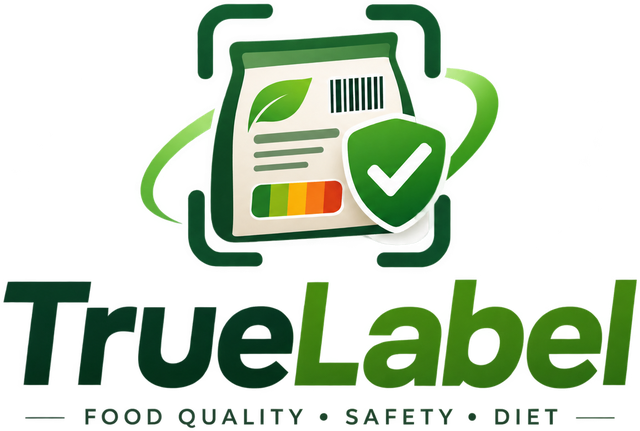
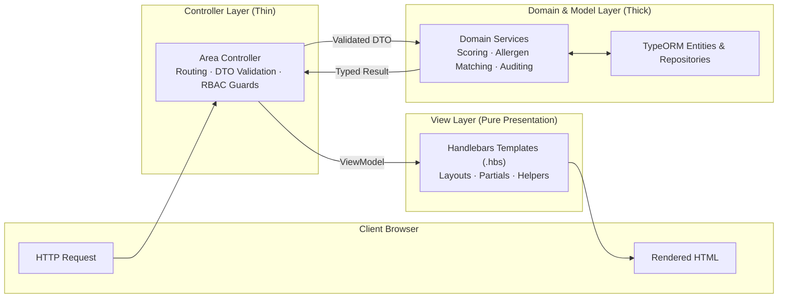

<div align="center">

<a href="https://truelabel.up.railway.app/">
  <picture>
    <source media="(prefers-color-scheme: dark)" srcset="./public/images/logo-dark.png" />
    <source media="(prefers-color-scheme: light)" srcset="./public/images/logo.png" />
    
  </picture>
</a>

<h3>Explainable Food Quality, Safety Verification &amp; Personalized Allergen Intelligence</h3>

<p>
  <a href="https://truelabel.up.railway.app/"></a>
  <a href="https://youtu.be/E8ALHdqVbfQ"></a>
</p>

<p>
  
  
  
  
  
  
  
</p>

<p>
  <a href="https://truelabel.up.railway.app/">Live App</a> &middot;
  <a href="#sprint-1-video-demonstration">Sprint 1 Video</a> &middot;
  <a href="#core-features">Features</a> &middot;
  <a href="#stakeholder-roles">Roles</a> &middot;
  <a href="#demo-accounts">Demo Accounts</a> &middot;
  <a href="#architecture">Architecture</a> &middot;
  <a href="#getting-started">Getting Started</a> &middot;
  <a href="#testing">Testing</a>
</p>

</div>

---

## Live Deployment & Demonstration

- **Live Application URL:** [https://truelabel.up.railway.app/](https://truelabel.up.railway.app/)
- **Sprint 1 Video Walkthrough:** [https://youtu.be/E8ALHdqVbfQ](https://youtu.be/E8ALHdqVbfQ)

| Resource | Link | Description |
| :--- | :--- | :--- |
| **Live Platform** | [`truelabel.up.railway.app`](https://truelabel.up.railway.app/) | Live production deployment hosted on Railway |
| **Sprint 1 Video** | [`youtu.be/E8ALHdqVbfQ`](https://youtu.be/E8ALHdqVbfQ) | End-to-end video walkthrough demonstrating all Sprint 1 features |
| **Food Catalog** | [`/catalog`](https://truelabel.up.railway.app/catalog) | Search packaged foods, inspect nutrition facts, and view 0–100 quality scores |
| **Safety Documents Registry** | [`/safety/documents`](https://truelabel.up.railway.app/safety/documents) | Browse verified lab reports and compliance certificates |
| **Verify Manufacturer Licence** | [`/safety/licence/verify`](https://truelabel.up.railway.app/safety/licence/verify) | Cross-check BSTI, BFSA, FDA, and Halal licences |
| **Standards & Methodology** | [`/about`](https://truelabel.up.railway.app/about) | Platform scoring methodology and transparency standards |
| **Sign In** | [`/auth/login`](https://truelabel.up.railway.app/auth/login) | Access role-specific dashboards using the [demo accounts](#demo-accounts) |

---

## Sprint 1 Video Demonstration

Comprehensive video demonstration walking through TrueLabel's multi-stakeholder workflows, role-tailored dashboards, explainable 0–100 food quality scoring, Big-9 allergen profiling, compliance certificate verification, and community incident reporting:

<div align="center">
  <a href="https://youtu.be/E8ALHdqVbfQ" target="_blank" rel="noopener noreferrer">
    
  </a>
  <br /><br />
  <p>
    <a href="https://youtu.be/E8ALHdqVbfQ" target="_blank" rel="noopener noreferrer">
      
    </a>
  </p>
  <p>
    <strong>Direct Link:</strong> <a href="https://youtu.be/E8ALHdqVbfQ">https://youtu.be/E8ALHdqVbfQ</a>
  </p>
</div>

---

## Overview

Packaged food labels are often hard to interpret, conceal harmful additives behind technical codes, and leave families guessing about allergens and manufacturer legitimacy. **TrueLabel** bridges the gap between everyday consumers, compliant food brands, and regulatory safety inspectors on a single verifiable platform.

Built with **NestJS**, **TypeORM**, **Handlebars (SSR)**, and **PostgreSQL (Supabase)** following a strict **Model-View-Controller (MVC) Areas** architecture, TrueLabel combines explainable food quality scoring, automated Big-9 allergen warnings, accredited document auditing, and credibility-weighted community feedback.

---

## Core Features

### 1. Food Catalog & Explainable Quality Scoring (`food-catalog`)
- **Multi-facet Discovery**: Filter packaged products by keyword, category, brand, dietary tags, or direct barcode lookup (`/catalog/barcode/:barcode`).
- **Explainable 0–100 Quality Score**: Transparent scoring backed by nutrient density, additive hazard tiers (`safe`, `caution`, `warning`), and verified formulation data.
- **Authentic Nutrition Facts & Ingredient Indexing**: Standardized per-100g and per-serving nutrition panels alongside flagged allergens and E-number/additive explanations.
- **Manufacturer Catalog Management**: Authenticated manufacturers and admins can register new products, update formulations, and archive listings with strict ownership enforcement.

### 2. Personalized Allergen & Dietary Profiling (`personal-food`)
- **Saved Health & Allergen Profiles**: Consumers configure their Big-9 allergens (milk, eggs, fish, shellfish, tree nuts, peanuts, wheat, soy, sesame) and dietary preferences.
- **Automated Conflict Alerts**: Product pages dynamically highlight personal allergen hazards and dietary mismatches tailored to the signed-in consumer.

### 3. Food Safety Documents & Licence Verification (`food-safety`)
- **Compliance Accreditation Uploads**: Food manufacturers submit laboratory analysis reports, ISO/Halal certificates, and statutory compliance filings (`/safety/documents/upload`).
- **Regulatory Audit Bench**: Safety inspectors review pending certificates and record formal **Approved** or **Rejected** decisions with mandatory audit reasons.
- **Public Licence Lookup**: Anyone can verify manufacturer trade and food-safety licences (BSTI, BFSA, FDA) against the official registry (`/safety/licence/verify`).

### 4. Community Reviews & Safety Incident Reporting (`community`)
- **Credibility-Weighted Reviews**: Consumers write, edit, and manage structured product reviews with server-computed credibility scoring; manufacturers can post official brand responses.
- **Consumer Safety Reports with Evidence**: Consumers file safety complaints (e.g., tampering, undeclared allergens, spoilage) with private photo evidence stored via Supabase Storage (with automatic local private storage fallback).
- **Inspector Complaint Queue**: Inspectors and administrators triage reported products, inspect evidence securely via authorized routes, and update investigation statuses.

### 5. Role-Tailored Navigation, Dashboards & Security (`identity` & `common`)
- **Four Dedicated Role Workspaces**: Tailored dashboards and navigation menus for **Consumers**, **Food Manufacturers**, **Safety Inspectors**, and **System Administrators**.
- **Defense-in-Depth Security**: Session-based authentication (`bcryptjs` password hashing), `@Roles(...)` RBAC guards, CSRF token protection, authentication rate limiting, and contextual user-friendly 403/404/400 error views.
- **Anti-FOUC Light & Dark Mode**: Instant theme switching across every view, FDA nutrition panel, and brand logo asset without flash of unstyled content.

---

## Stakeholder Roles

| Role | Primary Capabilities | Access Boundaries |
| :--- | :--- | :--- |
| **Guest** | Browse catalog, inspect quality scores & nutrition panels, view verified safety documents, verify licences | Read-only; cannot submit reviews, file reports, or save personal profiles |
| **Consumer** | All guest capabilities + personal dietary/allergen profile, automated hazard warnings, product reviews, safety incident reports | Cannot register/edit products, upload certificates, or moderate complaints |
| **Food Manufacturer** | Register & manage own products, upload compliance certificates, post official replies to product reviews | Cannot edit another brand's products or approve own safety documents |
| **Safety Inspector** | Audit & approve/reject submitted safety certificates with audit reasons, investigate consumer complaint queue | Cannot upload manufacturer certificates or manage user accounts |
| **Administrator** | Full system governance, user & role management console, oversight across catalog, documents, and complaints | Full platform administration with enforced validation & CSRF controls |

---

## Demo Accounts

The database seed (`npm run seed`) provisions ready-to-use demo accounts for every stakeholder role. All demo accounts use the password **`password123`**:

| Role | Name | Email | Password |
| :--- | :--- | :--- | :--- |
| **Consumer** | Sharah Consumer | `consumer@truelabel.demo` | `password123` |
| **Manufacturer** | PureHarvest & Aarong Dairy | `manufacturer@truelabel.demo` | `password123` |
| **Safety Inspector** | Dr. Marcus Vance (Inspector) | `inspector@truelabel.demo` | `password123` |
| **Administrator** | Lead System Admin | `admin@truelabel.demo` | `password123` |

> Additional seeded manufacturer accounts (`pran@truelabel.demo`, `nestle@truelabel.demo`, `oatly@truelabel.demo`, `heinz@truelabel.demo`) and a secondary consumer (`tariq.consumer@truelabel.demo`) are also included in [`src/config/seed.service.ts`](./src/config/seed.service.ts).

---

## Architecture

TrueLabel enforces strict **Model-View-Controller (MVC)** separation organized by **Domain Areas**:



### Project Structure

```text
TrueLabel/
├── src/
│   ├── main.ts                         # NestJS bootstrap, sessions, CSRF middleware & HBS helpers
│   ├── app.module.ts                   # Root module wiring all Area modules & global filters
│   ├── config/                         # TypeORM (PostgreSQL / sql.js fallback), Supabase & SeedService
│   ├── common/
│   │   ├── decorators/                 # @Roles(), @CurrentUser()
│   │   ├── filters/                    # AuthExceptionFilter (friendly 401/403/404/400 handling)
│   │   └── guards/                     # AuthenticatedGuard, RolesGuard, CsrfGuard, AuthThrottlerGuard
│   ├── areas/
│   │   ├── home/                       # Landing page, About, Contact, Terms, Privacy, Cache Policy
│   │   ├── identity/                   # Auth (login/register/logout) & role-specific Dashboards
│   │   ├── food-catalog/               # Catalog search, barcode lookup, quality scoring, CRUD
│   │   ├── personal-food/              # Consumer dietary & Big-9 allergen preference profiles
│   │   ├── food-safety/                # Compliance documents, inspector review, licence verification
│   │   └── community/                  # Credibility-scored reviews, incident reports & photo evidence
│   ├── shared/views/                   # Main layout, role-tailored navbar, footer, 403 & 404 pages
│   └── scripts/seed.ts                 # Standalone CLI database seeder
├── database/migrations/                # Versioned SQL migrations for PostgreSQL / Supabase
├── public/
│   ├── css/style.css                   # Custom editorial typography, FDA panel & dark mode system
│   ├── images/                         # Light & dark brand logos, emblem marks, and wordmarks
│   └── favicon.png                     # Site favicon
└── test/                               # End-to-end integration test configuration
```

---

## Tech Stack

| Layer | Technology |
| :--- | :--- |
| **Backend Framework** | NestJS 10, Express, TypeScript 5.7 |
| **Server-Side Views** | Handlebars (`hbs`) with custom domain helpers |
| **Styling & Design** | Tailwind CSS + custom editorial & dark-mode CSS (`public/css/style.css`) |
| **Database & ORM** | PostgreSQL (Supabase) via TypeORM 0.3, with zero-config `sql.js` (SQLite) offline fallback |
| **File Storage** | Supabase Private Storage Bucket (`report-evidence`) with local private fallback |
| **Authentication & Security** | `express-session`, `bcryptjs`, `class-validator`, CSRF Guard, RBAC RolesGuard |
| **Testing** | Jest, `@nestjs/testing`, Supertest |
| **Hosting** | Railway ([truelabel.up.railway.app](https://truelabel.up.railway.app/)) |

---

## Getting Started

### Prerequisites

- **Node.js** `>= 18.x` and **npm** `>= 9.x`
- *(Optional)* A **PostgreSQL** or **Supabase** database — if `DATABASE_URL` is omitted, TrueLabel automatically runs with a local `sql.js` SQLite database (`truelabel_dev.sqlite`) for instant offline development.

### 1. Clone & Install

```bash
git clone https://github.com/heisenberg-611/TrueLabel.git
cd TrueLabel
npm install
```

### 2. Configure Environment Variables

Copy the template and fill in your credentials:

```bash
cp .env.example .env
```

| Variable | Required | Description |
| :--- | :---: | :--- |
| `PORT` | No | Server port (default: `3000`) |
| `SESSION_SECRET` | Yes | Long random string used to sign session cookies |
| `DATABASE_URL` | Optional | PostgreSQL / Supabase connection URI (falls back to local `sql.js` if omitted) |
| `DB_SYNC` | No | Set `false` in production to rely on SQL migrations in `database/migrations/` |
| `SUPABASE_URL` | Optional | Supabase project URL |
| `SUPABASE_ANON_KEY` | Optional | Supabase anonymous public key |
| `SUPABASE_SERVICE_ROLE_KEY` | Optional | Server-only key for private `report-evidence` photo uploads (never exposed to browser) |

### 3. Seed the Database

Populate authentic sample products, nutrition facts, manufacturer licences, safety documents, reviews, and demo accounts:

```bash
npm run seed
```

### 4. Run the Application

```bash
# Development mode (watch)
npm run start:dev

# Production build & start
npm run build
npm run start:prod
```

Visit **[http://localhost:3000](http://localhost:3000)** in your browser.

---

## Available Scripts

| Command | Description |
| :--- | :--- |
| `npm run start:dev` | Start NestJS in watch mode for local development |
| `npm run build` | Compile TypeScript and copy Handlebars view assets to `dist/` |
| `npm run start:prod` | Run the compiled production server (`node dist/main`) |
| `npm run seed` | Seed the database with demo users, products, licences, and safety records |
| `npm run seed:prod` | Run the compiled seeder against the production build |
| `npm test` | Run the full Jest unit test suite |
| `npm run test:cov` | Generate code coverage report |
| `npm run test:e2e` | Run end-to-end integration tests |
| `npm run format` | Format source and test files with Prettier |

---

## Testing

TrueLabel maintains a comprehensive unit test suite covering controllers, domain services, DTO validation, credibility algorithms, security guards, exception filters, and dark-mode/brand asset integrity.

```bash
npm test
```

- **24 test suites** passing
- **228 unit tests** passing

---

<details>
<summary><strong>Route Reference (Click to expand)</strong></summary>

| Area | Method & Route | Access | Purpose |
| :--- | :--- | :--- | :--- |
| **Home** | `GET /`, `/about`, `/contact`, `/terms`, `/privacy`, `/cache-policy` | Public | Landing page & standards documentation |
| **Auth** | `GET/POST /auth/login`, `GET/POST /auth/register`, `POST /auth/logout` | Public / Auth | Session authentication |
| **Dashboards** | `GET /dashboard` (`consumer`, `manufacturer`, `inspector`, `admin`) | Role-gated | Role-tailored workspaces & admin user CRUD |
| **Catalog** | `GET /catalog`, `GET /catalog/product/:id`, `GET /catalog/barcode/:barcode` | Public | Food discovery, scoring & nutrition panels |
| **Catalog Manage** | `GET/POST /catalog/manage/create`, `/:id/edit`, `/:id/archive` | Manufacturer, Admin | Product lifecycle management |
| **Personal Food** | `GET/POST /personal/profile` | Authenticated | Dietary preferences & Big-9 allergen alerts |
| **Food Safety** | `GET /safety/documents`, `GET /safety/licence/verify` | Public | Verified safety registry & licence lookup |
| **Safety Upload** | `GET/POST /safety/documents/upload` | Manufacturer, Admin | Submit compliance certificates |
| **Safety Review** | `POST /safety/documents/:id/review` | Inspector, Admin | Audit & approve/reject certificates |
| **Reviews** | `GET /community/products/:id/reviews`, `POST .../reviews`, `.../reply` | Public / Consumer / Brand | Credibility-weighted reviews & brand replies |
| **Reports** | `GET/POST /community/products/:id/report`, `GET /community/reports/mine` | Consumer | Submit & track safety incident reports |
| **Complaint Queue** | `GET /community/reports/queue`, `POST /community/reports/:id/status` | Inspector, Admin | Investigate & resolve safety complaints |

</details>

---

## Academic Context

Developed as part of **CSE470 — Software Engineering** at **BRAC University (Group 7)**, strictly adhering to MVC architectural discipline, role-based access boundaries, and automated verification.

- **Sprint 1 Video Walkthrough:** [https://youtu.be/E8ALHdqVbfQ](https://youtu.be/E8ALHdqVbfQ)
- **Live Deployment:** [https://truelabel.up.railway.app/](https://truelabel.up.railway.app/)

<div align="center">
  <br />
  <sub>Built with care by Team TrueLabel &middot; <a href="https://truelabel.up.railway.app/">truelabel.up.railway.app</a> &middot; <a href="https://youtu.be/E8ALHdqVbfQ">Sprint 1 Video</a></sub>
</div>
